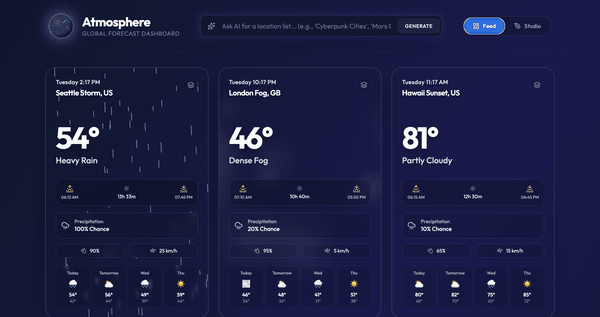
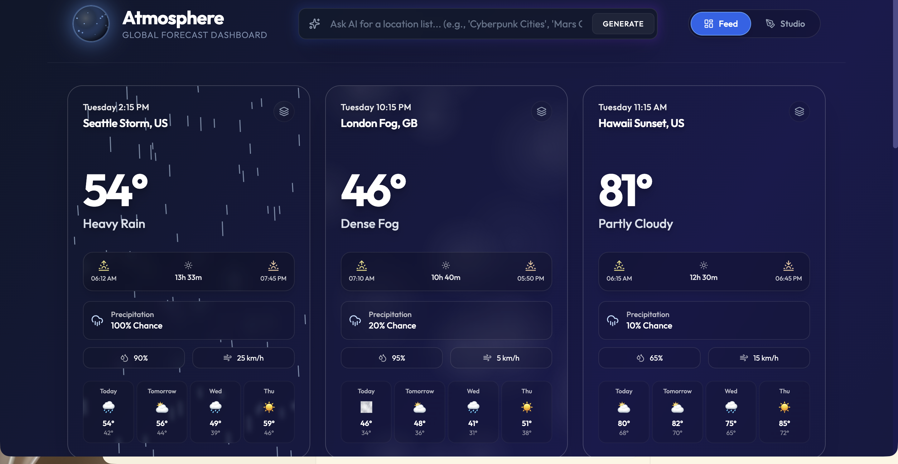
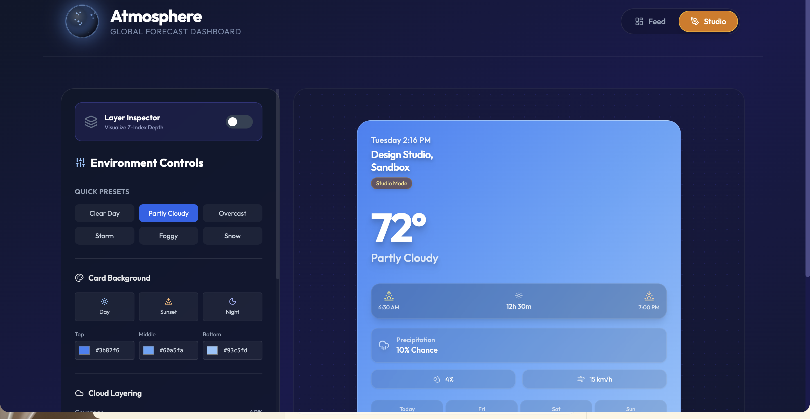

# Atmosphere: 3D Weather Gallery



A visually rich, 3D-enhanced weather dashboard showcasing atmospheric conditions for global cities. Each card renders volumetric clouds, rain, snow, and dynamic lighting through custom WebGL shaders — all driven by React Three Fiber.



## Quick Start

```bash
git clone https://github.com/andrewvoirol/atmosphere-3d-weather-gallery.git
cd atmosphere-3d-weather-gallery
npm install
npm run dev
```

Opens at `http://localhost:3000`.

**Node.js 18+** required.

## How It Works

Switch between **Feed** and **Studio** using the toggle in the header.

**Feed** shows a masonry grid of 9 weather cards, each with:
- Custom volumetric cloud shaders rendered via a shared R3F Canvas
- 2D canvas precipitation effects (rain streaks, snowflakes)
- Glassmorphism UI with sunrise/sunset, humidity, wind, and 4-day forecast
- Lunar phase tracking for nighttime cards

**Studio** lets you tweak weather parameters in real time:
- Quick presets (Clear Day, Storm, Snow, Foggy, etc.)
- Card background colors (day/sunset/night palettes)
- Cloud layering controls (coverage, density, speed)
- Atmosphere settings (fog density, wind speed, cloud/fog colors)



### AI Location Generation (Optional)

Type a theme into the header prompt — "Cyberpunk Cities", "Mars Colonies", "Lord of the Rings" — and hit Generate. The app calls Gemini 2.5 Flash with a structured output schema to produce 9 themed locations with appropriate weather data.

To enable: set `VITE_GEMINI_API_KEY` in `.env.local` to a valid [Gemini API key](https://aistudio.google.com/apikey). The feed works perfectly without it using built-in demo data.

## Tech Stack

| Layer | Technology |
|---|---|
| Framework | React 19 |
| 3D | React Three Fiber 9 + drei 10 + Three.js 0.181 |
| Bundler | Vite 6 |
| Styling | Tailwind CSS 3.4 |
| Animation | Framer Motion 12, custom GLSL shaders |
| AI | Google Gemini 2.5 Flash (`@google/genai`) |
| Icons | Lucide React |
| Language | TypeScript 5.8 |

## Project Structure

```
├── App.tsx              # Root — state, AI integration, Canvas + View.Port
├── index.tsx            # React entry point
├── constants.ts         # Mock data, weather themes, icon mapping, lunar phases
├── types.ts             # TypeScript interfaces
├── components/
│   ├── WeatherCard.tsx  # Primary card UI — 3D View, glassmorphism, 2D effects
│   ├── Cloud3D.tsx      # Custom CloudHyperMaterial shader, volumetric rendering
│   ├── DesignStudio.tsx # Interactive parameter editor + live preview
│   └── GlobeLogo.tsx    # Animated SVG logo
```

## License

MIT
